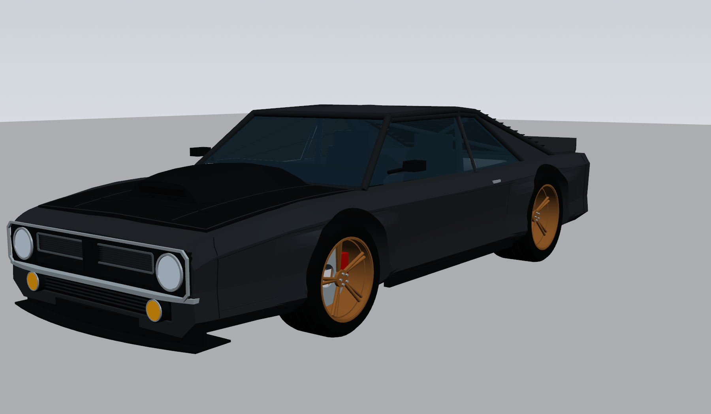

# Hemi-Cuda-Cat

A 1969 Barracuda fastback restomod concept powered by a Hellcat / Demon 170 supercharged 6.2L HEMI V8, designed as a parametric 3D CAD model in Python (CadQuery).

[View the interactive 3D model](https://claude.ai/artifact/GKeZraKuBn6Zb5zzizrnd1)

## The build

- **Engine:** Hellcat / Demon 170 supercharged 6.2L HEMI V8
- **Transmission:** 8-speed automatic
- **Rear end:** Ford 9-inch
- **Chassis:** custom box frame
- **Suspension:** air bags. Lays out on rubber bump stops on the frame, raises 10 in
- **Wheels:** staggered, 20 in front / 22 in rear
- **Body:** 1969 Barracuda fastback with molded flares
- **Front:** simple air dam with a splitter blade that sticks out past the bumper

## Status

**Rev B: mechanical layout.** The wheels and track are set so the car lays out on the frame stops. Flare styling is still being refined. Next step: measure the donor engine and transmission to replace the estimated drivetrain envelope.

---

*HEMI, Barracuda, 'Cuda, Hellcat and Demon are trademarks of FCA US LLC (Stellantis). This is an independent project, not affiliated with or endorsed by Stellantis.*
